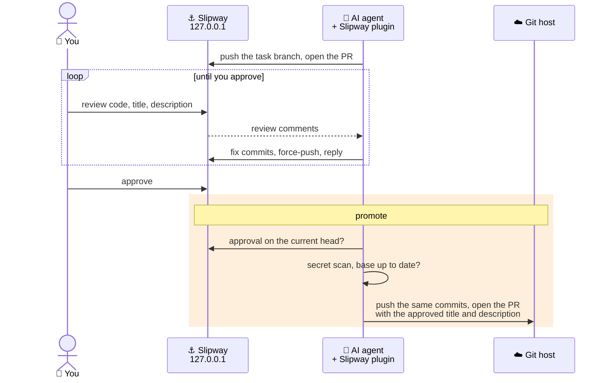

<p align="center">
  <picture>
    <source media="(prefers-color-scheme: dark)" srcset=".github/assets/slipway-logo-dark.svg">
    
  </picture>
</p>

<p align="center">
  A local pull-request server for coding agents. Review on your machine, publish to GitHub only what you approved.
</p>

<p align="center">
  <a href="LICENSE"></a>
  
  
</p>

---

**Slipway** is three parts:

- **A local Git server.** Bound to `127.0.0.1`, with merging disabled. It hosts a copy of each registered repository and its pull
  requests, and gives you a web UI to review them.
- **A Claude Code plugin.** An MCP server, skills and a hook. Claude Code pushes branches and opens pull requests in Slipway instead of
  on GitHub, reads your review comments and answers them.
- **A CLI, `slipway`.** It starts and stops the server, registers repositories and promotes approved pull requests to GitHub.

## How it works



1. Claude Code works on its own task branch, named by the repository's rules (`agent/<task>-<slug>` when there are none), and
   opens the pull request in Slipway with a title and description that follow the repository's PR conventions.
2. You review it in the browser: the code, the title and the description.
3. Claude Code reads the review, folds each fix into the commit it belongs to and replies to every thread. Repeat as needed.
4. You approve.
5. On `promote`, Slipway checks your approval on the current head, scans the commits with gitleaks and pushes exactly those commits to
   GitHub with the approved title and description. Your GitHub access comes from `gh` at that moment and is never stored.

If `main` moved on GitHub in the meantime, promotion stops. Claude Code rebases in Slipway and the pull request needs a fresh approval.

## Install

Requirements: macOS or Linux, `git`, and the [GitHub CLI](https://cli.github.com) signed in (`gh auth login`).

```bash
brew install coldic3/tap/slipway     # or: npm install -g @coldic3/slipway   (Node 22+)
slipway init
```

`slipway init` asks which agent to set up, starts the server, creates your login and installs the Claude Code plugin. Then open
http://127.0.0.1:3514 and sign in as **slipway** / **slipway**.

Register a repository (its `origin` must be on GitHub):

```bash
cd your-project
slipway repo add .
```

In Claude Code: *"Implement X and open a Slipway PR."* After your review: *"Fix the review."* After your approval: *"Promote it."*

### Options

| | |
|---|---|
| Runtime | The server runs as a native binary in `~/.slipway` (downloaded once, sha256-pinned). Use Docker instead: `slipway init --docker`. |
| Port | Default `3514`. If it is taken, `slipway init` offers a free one. Override: `--port N` or `SLIPWAY_PORT`. |
| After a reboot | The plugin starts the server on its first call. Or run `slipway up`. |
| Plugin by hand | `/plugin marketplace add coldic3/slipway`, then `/plugin install slipway@slipway`. |

## Supported platforms

Slipway currently supports Claude Code as the AI agent and GitHub as the Git host, and both are built in directly. The plan is to make
Slipway extensible, so that other AI agents and Git hosts (such as GitLab) can be added as integrations in future releases.
Contributions are welcome.

## Commands

```bash
slipway init [--agent claude-code|none] [--port N] [--docker] [--yes]
slipway up [--port N] [--docker]      # start the server
slipway down [--purge]                # stop it (--purge deletes all Slipway data)
slipway status
slipway repo add <clone> [--name n] [--github owner/repo] [--base main]
slipway promote <repo> <pr> [--draft] [--base b] [--test-cmd "…"] [--force]
slipway sync-main <repo>
slipway setup | --help | --version
```

The full guide (the review loop, the plugin's tools and skills, troubleshooting) is in [docs/plugin.md](docs/plugin.md).

## Guarantees

| | |
|---|---|
| Local only | The server listens on `127.0.0.1` and requires sign-in. |
| No merges | Every merge style is disabled and `main` is protected. Code leaves only through promotion. |
| Separate accounts | You review as `slipway`, a plain user. Claude Code has its own user that can push and comment, but not approve or merge. Repositories belong to the `repos` org, run by a technical `admin` account. |
| Exact promotion | Only with your approval on the current head; the commits you reviewed are the commits that reach GitHub. |
| Secret scan | gitleaks fails closed: a finding, an error or a missing scanner blocks promotion. |
| No stored GitHub token | The token is read from `gh` at promotion time and never written to disk. |
| Push guard | The plugin's hook blocks `git push` and `gh pr create` to GitHub for branches whose Slipway pull request is open or missing. |

Slipway is a workflow tool, not a sandbox: the agent runs as your OS user and could bypass it on purpose. Avatars are loaded from
Gravatar (an e-mail hash is sent to gravatar.com).

## Development

```bash
npm install
bin/slipway --help           # the CLI from source
npm test                     # unit + functional (Vitest)
npm run test:e2e             # Playwright against an isolated server on port 3300 (SLIPWAY_E2E_RUNTIME=docker for Docker)
npm run build:plugin         # rebuild plugin/dist after changing src/ (committed; a test fails if stale)
```

Design decisions: [docs/adr](docs/adr). Releasing: [docs/releasing.md](docs/releasing.md). After changing the logo or the web UI
styles, run `npm run build:brand`.

## License

[MIT](LICENSE)
